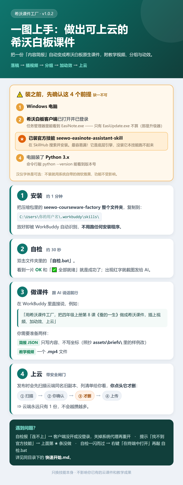

# 希沃课件工厂 · 安装与上手

> 把一份「简报 JSON」端到端做成**可上云的希沃白板原生课件**（`.enbx`）：
> 落稿 → 插教学视频 → 分组 → 注动效 → 发布上云 → 逐页核验。
>
> 本技能**补齐**官方 `seewo-easinote-assistant-skill` 没有的四块：像素坐标版式、插视频、动效、副本治理。
> 它**不下载教材**——上游请先用「国家智慧中小学教材提取」（`smartedu-textbook-organize`）。

<p align="center">
  
</p>

---

## 一、装之前：4 条硬依赖（逐条确认）

| # | 依赖 | 怎么确认 |
|---|---|---|
| 1 | **Windows** 电脑 | — |
| 2 | **希沃白板客户端**已启动并**登录**（本地 7916 端口在听） | `tasklist \| findstr EasiNote` 有 `EasiNote.exe`；任务管理器里能看到主程序，**不是**只有 `EasiUpdate*.exe`（那是升级器） |
| 3 | **官方技能** `seewo-easinote-assistant-skill` | 已装在 `~/.workbuddy/skills/` 下 |
| 4 | **Python 3.x** + 依赖包 | `python-docx` `Pillow` `opencv-python` `pymupdf` `fonttools`（本技能脚本用到） |

> 第 5 条**可选**：汉仪字体（自动安装脚本 `scripts/版式库/install_fonts.py`）。用官方默认「微软雅黑」则无需装。
> ⚠️ 汉仪字体**商用需授权**；本技能**不分发**字体文件。

---

## 二、安装

把整个 `seewo-courseware-factory/` 目录放到**用户级技能目录**：

```
C:\Users\<你的用户名>\.workbuddy\skills\seewo-courseware-factory\
```

放好即被 WorkBuddy 自动识别（技能名 `seewo-courseware-factory`）。
若你是从本机导出的，原作者可用一条命令安装：

```bash
python scripts/_sync_check.py --install                      # 默认装到 ~/.workbuddy/skills/seewo-courseware-factory
python scripts/_sync_check.py --install --install-dir <目录>  # 自定义
```

---

## 三、装完先自检（30 秒）

**最省事**：双击技能根目录的 **`自检.bat`** —— 它会自动找到 Python，然后依次跑下面两条命令，最后停在结果上等你按键。

> 在 GitHub 网页上预览 `自检.bat` 会显示乱码，这是**正常的**：它按 Windows 命令行的要求用 **GBK 编码 + CRLF + 无 BOM** 写入，下载到本地双击可正常运行。若你想改它，请保持这三条，否则 cmd 会静默吃字符。

```bash
python scripts/seewo_config.py     # 应 6 项全 OK：skill_dir / account / courseware_db / easinote_exe / python
python scripts/_selftest.py        # 16 个库型脚本 import + 3 个 CLI --help + 官方依赖链
```

任何一项报错，先看 `references/07-踩坑总表.md`；**最常见的两类**：
- **探测到 `None` / 连不上 7916** → 客户端没开，或环境里有 `http_proxy` 等代理变量（本技能已内置自动剥离，若仍报错请手动 `unset http_proxy https_proxy HTTP_PROXY HTTPS_PROXY ALL_PROXY all_proxy`）。
- **找不到官方技能** → 设环境变量 `SEEWO_SKILL_DIR` 指向官方技能目录。

---

## 四、三步跑通（以"第8课"为例）

```bash
# ① 写简报 JSON（只写内容，不写坐标）→ 生成 pages.json
python scripts/版式库/make_deck.py --brief assets/briefs/第8课-蚕的一生.json --out 第8课/pages.json
python scripts/版式库/check_geometry.py --spec 第8课/pages.json      # 几何体检，6 项应为 0

# ② 落稿成干净源 .enbx（--no-sync = 只本地，不上云；需客户端在线）
python scripts/run_build_v2.py --spec 第8课/pages.json --no-sync

# ③ 一条流水线：插视频 → 分组 → 注动效 →（可选）发布上云
python scripts/seewo_build.py 第8课/v2/pipeline.json --dry-run       # 先干跑看命中
python scripts/seewo_build.py 第8课/v2/pipeline.json --publish       # 真跑并上云
```

**顺序铁律**：`① 落稿 → ② 插视频 → ③ 分组 → ④ 注动画 → ⑤ 发布`，**不可换**（插视频会整页重写，毁掉分组）。

`pipeline.json` / `group.json` / `anim.json` 的写法见 `assets/examples/` 三个示例文件。

---

## 五、上云与"副本不堆积"

- **根因**：每次"本地 enbx → 打开 → 同步"都会在云端**新建一份**，同一个课件越攒越多。
- **本技能做法**：发布前**先扫描云端同名旧副本 → 列出清单 → 你勾选 → 只删勾选 → 再上传** ⇒ 云端恒 1 份。
- **删除前置闸门**（安全设计）：**不带勾选参数时只扫描、不删**；默认全留；有保护名单；优先走回收站。

```bash
python scripts/publish_courseware.py "<enbx>" --cleanup          # ① 只扫描，列候选（不删、也不上传）
#     ↑ 看完候选后，确认要删就加 --yes 重跑（这一步才是"你点头"）
python scripts/publish_courseware.py "<enbx>" --cleanup --yes    # ② 删同名旧副本 → 再上传（云端恒 1 份）
python scripts/_verify_v2.py <本地 enbx> <云端缓存目录>            # 逐页核验，差异页应为 0
```

> 流水线里由 `pipeline.json` 的 `publish.cleanup` 控制：**缺省 false = 不清理**；写 `true` 即视为已授权。
> 保护名单：环境变量 `SEEWO_NEVER_DELETE` 或 `scripts/never_delete.txt` 里列出的名字，一律拒绝删除。

---

## 六、目录说明

| 路径 | 内容 |
|---|---|
| `SKILL.md` | 技能主入口（给 AI 读的操作手册：全流程 / 铁律 / 检查清单 / 排障树） |
| `README.md` | 本文件（给人读的安装与上手） |
| `references/00–07` | 8 份知识分册：上游衔接 / 版式库 / 动效边界 / 插视频 SOP / 上云治理 / 验收排障 / 字体 / 踩坑总表 |
| `scripts/` | 工具集（`版式库/` 子目录 = 简报→版面） |
| `assets/` | 样例简报 ×3 + JSON 示例 ×3 |
| `VERSION` | **本技能版本号**（单行，如 `1.0.1`） |
| `CHANGELOG.md` | 各版本「改了什么 / 要不要重装」，倒序 |
| `_INSTALL.json` | 安装记录（在**安装位置**里，含 `skill_version` 与安装时间） |

---

## 七、版本与更新

| 想知道 | 看哪里 |
|---|---|
| 我装的是哪一版 | 技能根 `VERSION` 文件，或 `_INSTALL.json → skill_version` |
| 新版改了什么 | `CHANGELOG.md`（倒序，最新在最上） |
| 要不要重装 | 每条 CHANGELOG 末尾都写了「要不要重装」 |

**更新方法（三步）**：

1. 收到新包，把包名里的版本号与自己的 `VERSION` 比一下，更大 → 需要更新；
2. 把新的 `seewo-courseware-factory/` 文件夹**整个覆盖**到 `~/.workbuddy/skills/`（**不会**丢你的课件——本技能不含任何成果课件）；
3. 双击 `自检.bat` 确认仍全绿；若这次更新改了技能描述 / 触发词，**重启 WorkBuddy** 让新描述生效。

> 覆盖是**幂等**的：只更新技能自身文件，**不碰**你的工作目录与云端课件。

---

## 八、分享前请自查（作者用）

- ✅ 无账号 / 手机号 / 机器路径硬编码（本技能已全部走 `scripts/seewo_config.py` 自动探测）
- ✅ 不含**字体文件**（汉仪字体有授权与体积问题）
- ✅ 不含**个人成果课件**与 `_规划/` 内部规划件
- ✅ `python scripts/_sync_check.py --check` 通过（脚本快照与开发主场一致）

---

## 九、本技能不做什么

- ❌ 不下载/解析教材 → 交 `smartedu-textbook-organize`
- ❌ 不产出"单文件 HTML 互动课件" → 交 `textbook-unit-courseware` / `teachany`
- ✅ 只做：**简报 → 希沃原生 enbx（含视频/分组/动效）→ 上云 → 验收**

---

## 十、开源协议与致谢

- 本项目采用 **MIT License**（见 `LICENSE`）：可自由使用、修改、再分发，保留版权声明即可。
- 依赖的官方技能 `seewo-easinote-assistant-skill` 由**希沃官方**提供，**不在本仓库内**，请自行从其官方渠道安装，并遵守其条款。
- **不分发任何字体文件**：汉仪字体商用需授权，本技能只在检测到本机已装字体时使用，否则回退系统「微软雅黑」。
- 本项目与希沃公司无隶属关系；「希沃」「EasiNote」等商标归其各自权利人所有。
- 仅供教学备课使用，请遵守所在学校与平台的使用规定。
